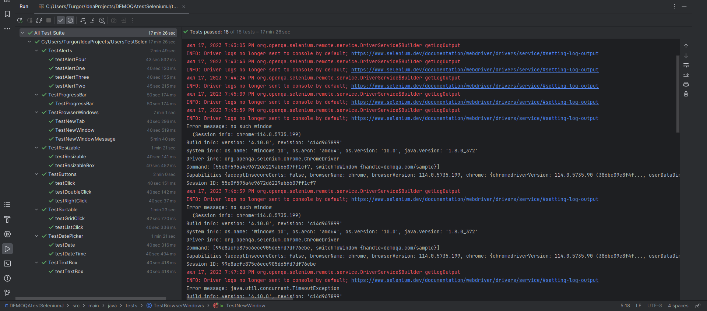
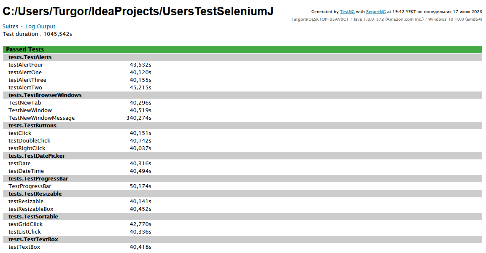
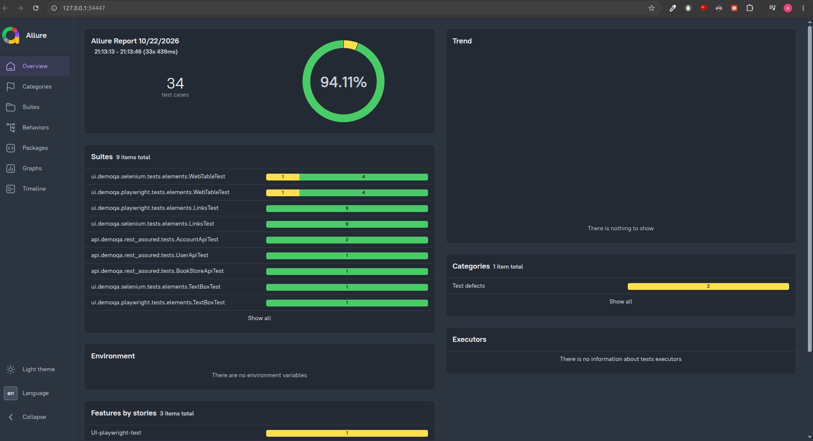
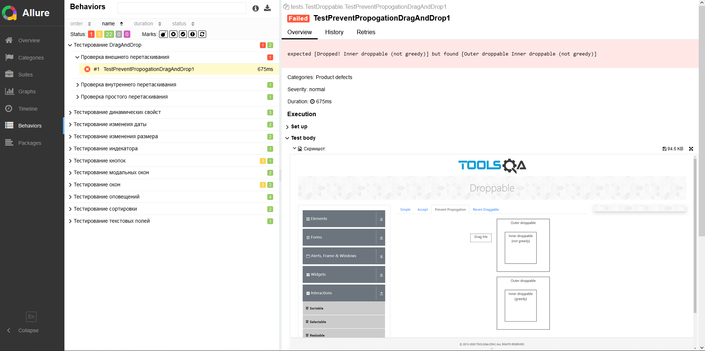

# DEMOQA test Selenium (Java)

## Описание

Цель проекта: получение навыков в написании автоматизированных тестов на Java.

Сайт для тестирования ([DEMOQA](https://demoqa.com)).

## Технологии

- Java
- Selenium
- junit
- Allure
- Maven

## Окружение

Для того чтобы запустить тесты, надо установить JDK, Maven и браузер Google Chrome:

```bash
wget https://dl.google.com/linux/direct/google-chrome-stable_current_amd64.deb
apt install -y ./google-chrome-stable_current_amd64.deb
```

## Состав проекта

- Папка (src/test) с Java тестами
- Папка (img) со скриншотами отчётов
- Файл (testng.xml) с настройками запуска TestNG
- Файл (pom.xml) с зависимостями проекта

## Selenium тесты

Запуск тестов

```bash
mvn clean test -DHEADLESS=false
```

Запуск с указанием конкретного набора тестов:

```bash
mvn clean test -DsuiteXmlFile=testng.xml
```

### TestNG отчёт

Пример запуска Selenium тестов (TestNG)



Отчёт TestNG



### Allure отчёт

Пример отчёта по Selenium тестам





Открыть отчёт

```bash
allure serve target/allure-results
```

## TODO

- [ ] Поправить faker
